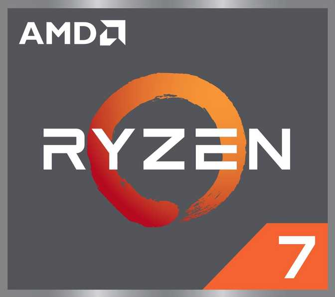

*There’s a common misconception that x86 is just a "power hog" compared to ARM, but the efficiency curve of modern x86 chips tells a much more nuanced story.*

# Intro

In recent years, following the release of the Apple M1 chip on November 10, 2020, the narrative around x86 processors has become quite predictable: high performance, but at the cost of high power usage and heat.
However, the "inefficient x86" label is undeserved and with each generation of x86 chips it is becoming more and more a relic of the past.
See, when we talk about CPU power, we usually focus on the "max turbo boost" numbers. But the real magic happens in the power-to-performance scaling. And x86 was undergoing a quiet revolution in this area for a while.

Today we will find the "sweet spot" of relatively modern mobile silicon, namely, Ryzen 7 6800H, by pushing it through its paces at 15W, 30W, and 45W.
By capping the aforementioned chip, I’ve gathered data that shows exactly how efficient the Zen 3+ architecture remains even when it's "starved" for power.

# The Hero

  

The AMD **Ryzen 7 6800H** is a high-end mobile APU released in 2022 based on the Zen 3+ microarchitecture. In terms of specs, everything is fairly straightforward:

- **8 cores** (**16 threads**) with a base clock of 3.2 GHz and turbo frequencies up to 4.7 GHz
- **16 MB** of shared **L3 cache**
- **Radeon 680M** (RDNA 2) integrated graphics
- Support for dual-channel **LPDDR5-6400** and DDR5-4800
- TDP **45 W**

It should be noted that the Ryzen 7 6800H is, by and large, only nominally the second-highest model in its lineup. Above it in the **Rembrandt** family there are only few Ryzen 9 69xx variants, which have maximum turbo frequencies that are at most a couple hundred MHz higher.

CPU-z

GPU-z

The Ryzen 7 6800H has become a fairly widespread processor, finding its way into a wide range of laptops—from compact ultrabooks to gaming models with discrete graphics—as well as mini-PCs. We will be testing the Ryzen 7 6800H installed in the **Lenovo ThinkBook 14 G4+ ARA** ultrabook. In this form factor, processors are rarely equipped with a discrete graphics card, and this Lenovo model is no exception. Thus, today we will be testing the Ryzen 7 6800H specifically as an **APU**, i.e., as a CPU + iGPU combination.

We will test performance in three modes, differing in their long-term power consumption limits: 45 W, 30 W and 15W. The first option is crystal clear—it’s simply AMD’s specification. The second adn third modes require a brief explanation.

The thing is, due to their small size, both laptops and mini-PCs rarely feature an effective cooling system. And one that’s both effective and quiet—practically never. At the same time, manufacturers of both the chips themselves and the devices equipped with them have been striving for many years to squeeze every last drop of performance out of the hardware right from the factory. Often sacrificing power consumption, heat dissipation, acoustic comfort, and battery life for the sake of a minor performance boost and victory in benchmarks.

But

Translated with DeepL.com (free version)

# 

Our goal is to determine how significantly reducing the power limit affects its performance, temperature, and battery life.

# Conclusion

The results suggest that x86 isn't just keeping up—it’s mastered the art of doing more with less.
Does doubling the wattage actually double your speed, or are we hitting diminishing returns? 